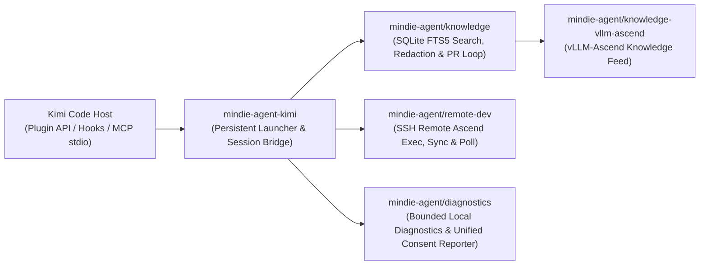

<p align="center">
  
</p>

<h1 align="center">MindIE Agent for Kimi Code</h1>

<p align="center">
  <b>Native Kimi Code Plugin for the Ascend NPU AI Infra Lifecycle</b><br/>
  <sub>Architecture Design · Feature Development · AscendC / Triton Kernels · Remote NPU Testing · Sanitized Experience Loop</sub>
</p>

<p align="center">
  <a href="LICENSE"></a>
  <a href="runtime-requirements.txt"></a>
  <a href="kimi.plugin.json"></a>
</p>

<p align="center">
  <a href="README.md">中文</a> | <b>English</b> ·
  <a href="#quick-start">Quick Start</a> ·
  <a href="#why-use-this-plugin">What Can It Do?</a> ·
  <a href="#everyday-usage--interaction">Usage</a> ·
  <a href="#architecture--component-map">Architecture</a> ·
  <a href="docs/README.en.md">Documentation</a>
</p>

---

**MindIE Agent for Kimi Code** (`mindie-agent-kimi`) is the native Kimi Code plugin adapter for [MindIE Agent](https://github.com/mindie-agent/mindie-agent), supporting the **Ascend NPU AI Infra design, development, and testing workflow**. In `v0.1.10` (paired with `mindie-agent 0.1.4`), it delivers **`vLLM-Ascend` feature development & testing**, **`AscendC` / `Triton` operator implementation & verification**, remote NPU execution, and sanitized public experience capture, while additional Ascend AI Infra domains continue expanding on the roadmap.

Designed around the [MindIE Agent Engineering Design Principles](https://github.com/mindie-agent/mindie-agent/blob/main/docs/design-principles.en.md), this thin adapter handles Kimi session identity, `wire.jsonl` public transcript extraction, MCP dispatch, and atomic generation updates, while delegating core knowledge, remote execution, and diagnostics to shared components.

> **Ecosystem & Release Note**: Currently `v0.1.10` (paired with `mindie-agent 0.1.4`) supports four hosts — Claude Code ([`mindie-agent-cc`](https://github.com/mindie-agent/mindie-agent-cc)), OpenAI Codex CLI ([`mindie-agent-codex`](https://github.com/mindie-agent/mindie-agent-codex)), Kimi Code (this repository), and DeepSeek Harness ([`mindie-agent-dsh`](https://github.com/mindie-agent/mindie-agent-dsh)) — all built on the same shared knowledge, remote-dev, and diagnostics components. See the [Documentation Index](#documentation-index) for per-host verification scope.

---

## Why Use This Plugin? (Trigger Modes & Usage Examples)

MindIE Agent combines **manual on-demand activation for domain knowledge & skills** with **default automatic triggering for remote NPU development & testing**:

| Capability | Trigger Mode | When to Use | How to Trigger |
| :--- | :--- | :--- | :--- |
| **Experience, Knowledge & Skill System**<br/>(`mindie-knowledge` + `mindie-agent` Skill) | **🎯 Manual Per-Session Trigger** | When designing Ascend AI Infra features, developing in `vLLM-Ascend`, writing `AscendC` / `Triton` kernels, authoring unit/accuracy tests, or tuning performance | Explicitly type **`/mindie-agent` + your task description** once in the current session to enable knowledge search (`knowledge_query` / `knowledge_explain`), feedback (`knowledge_feedback`), distillation (`knowledge_distill`), and sync (`knowledge_sync`) across subsequent turns (`/mindie-agent:deactivate` turns it off for the session) |
| **Remote Ascend NPU Dev & Component Tools**<br/>(`remote` + `components` MCP servers) | **⚡ Default Auto-Trigger** | When syncing local code/tests to a remote Ascend server/container, running NPU builds/tests, checking `npu-smi`, or calling local diagnostics, status checks, profiling, simulation, and device coordination tools | **No `/mindie-agent` required**—just describe the remote task or component invocation in natural language |
| **Experience Capture & Unified Contribution Switch**<br/>(`Stop` Auto-Capture + Gitleaks Redaction + Fault Reporting) | **🔄 Background Run in Enabled Sessions** | When contributing sanitized design, kernel development, testing, or tuning takeaways back to the open-source knowledge base, or reporting sanitized tool faults | **Configure Consent Once, Active in `/mindie-agent` Sessions**—once explicitly enabled in setup, every `/mindie-agent`-enabled session is redacted locally and packaged into a knowledge PR in the background; unactivated sessions perform zero `Stop` capture |

### Scenario 1: Type `/mindie-agent` for Feature Design, Kernel Development & Test Authoring (Manual Trigger)
> **Context**: Designing new Ascend features, implementing `AscendC` / `Triton` operators, or writing `vLLM-Ascend` accuracy tests benefits from prior architecture conventions, kernel constraints, and verified test patterns.  
> **Copy-Paste Example**:
> ```text
> /mindie-agent I want to design and implement a custom fused operator in vllm-ascend (with Triton / AscendC kernel support) and add unit + accuracy tests. Please check past experience and architecture conventions to propose an implementation plan.
> ```
> **What Happens**: Typing `/mindie-agent` activates the `mindie-agent` Skill and queries locally synced [`knowledge-vllm-ascend`](https://github.com/mindie-agent/knowledge-vllm-ascend) packages via SQLite FTS5, returning verified engineering cases complete with **applicable environments, evidence, and known caveats** as reference material.

### Scenario 2: Everyday Conversation Automatically Triggers Remote Ascend NPU Dev & Testing (`remote-dev` Default Auto-Trigger)
> **Context**: Your local machine is a macOS or Windows laptop while the Ascend NPU hardware lives on a remote Linux server or container.  
> **Copy-Paste Example (no slash command required)**:
> ```text
> Connect to the vllm_dev container on my remote 910B server, check current NPU memory usage, and sync my new operator implementation and rotary_embedding tests to run the full pytest verification suite.
> ```
> **What Happens**: The built-in `remote-dev` MCP server is always on and **triggers automatically by default** whenever your prompt involves remote servers, containers, or NPU commands—supporting remote command execution, file synchronization, and bounded background job polling over SSH even if knowledge capture is disabled.

### Scenario 3: Background Experience Capture & Unified Contribution Switch (`mindie-consent.json`)
> **Context**: You want to contribute reusable engineering takeaways back to the community while keeping internal IPs, keys, and private file paths out of public commits.  
> **Copy-Paste Example**:
> ```text
> /mindie-agent Help me complete the build and accuracy alignment verification for this custom Ascend operator using the knowledge base and our remote NPU container, and run the corresponding unit test once fixed.
> ```
> **Unified Contribution Switch & State Boundaries**:
> - **Single Persistent Switch**: Community knowledge sharing and automatic tool fault reporting share a single persistent switch in `mindie-consent.json`. Explicitly selecting `contribute` enables scoped public knowledge sharing and starts the native background fault reporter; selecting `disabled` stops subsequent outgoing sends for both paths.
> - **Upgrade Preservation & Legacy Re-Confirmation**: Existing `disabled`, `later`, and `read-only` choices stay off across upgrades. Legacy knowledge-only `contribute` records lacking the unified consent revision (`choice_revision` / marked `needs_choice`) do **not** automatically gain fault-upload permission on upgrade until explicitly re-confirmed once by the user.
> - **Three-State Separation**: The system strictly separates (1) local consent configuration written to disk, (2) background reporter or organizer worker running, and (3) external GitHub Issue or knowledge PR actually created. Use `/mindie-agent:reporting-status` for a read-only check of worker and queue state.
> - Read the **[User & Contribution Notice](skills/mindie-agent/references/user-notice.md)** for full details on sharing scope, redaction limits, and public Git history.
> - To set up a multi-task Git worktree layout for `vllm` and `vllm-ascend`, see **[Workspace Setup](skills/mindie-agent/references/workspace-setup.md)** and [vllm-ascend-workspace](https://github.com/mindie-agent/vllm-ascend-workspace.git).

---

## Quick Start

### Option 1: Automated Setup via Your AI Agent

Copy and paste the prompt below directly to Kimi Code (or any terminal-capable AI Agent) so it can run the prerequisite checks, build the locked runtime, and register the plugin:

```text
Please install https://github.com/mindie-agent/mindie-agent-kimi for me
```

<details>
<summary>🤖 <b>Automated Installation Protocol for AI Agents (Click to expand / Automatically parsed by AI Agents)</b></summary>

If you are an AI Agent asked by the user to install this plugin, execute the following deterministic steps directly in the terminal **without asking the user to read the documentation manually**:

1. **Check prerequisites, the `gh` GitHub channel (Hard Requirement), and SQLite FTS5 support**:
   **A stable, authenticated GitHub CLI (`gh`) channel is a hard requirement**—it powers source fetches, `knowledge-vllm-ascend` sync, automated PR publication (via `gh api` and `!gh auth git-credential`), and opt-in fault reporting:
   ```sh
   git --version
   gh --version
   GH_USER=$(gh api --hostname github.com user --jq .login) && echo "GitHub channel verified for account: $GH_USER"
   gh auth setup-git --hostname github.com
   kimi --version
   python3 -c "import sqlite3; assert sqlite3.sqlite_version_info >= (3, 43, 0), sqlite3.sqlite_version; print('SQLite OK:', sqlite3.sqlite_version)"
   ```
   - **Hard Gate (Never skip or silently ignore)**: If `gh` is missing, assist the user in installing it first (macOS: `brew install gh`; Windows: `winget install --id GitHub.cli`; Ubuntu / WSL: `sudo apt update && sudo apt install -y gh`). Reuse a working account. Otherwise follow [GitHub Sign-In](skills/mindie-agent/references/github-authentication.md): browser login on ordinary networks, or token login on enterprise networks / blocked browser authorization. Use an existing token in the hidden `gh` prompt (or a supplied private file), or guide token creation. Verify the account, Git and credential reuse before continuing; fix transport/certificate failures before retrying authentication.
   - Prefer Python 3.13. Windows requires Python >= 3.12 for nonblocking MCP pipes; POSIX requires Python >= 3.11. The linked SQLite library must be `>= 3.43.0` (compiled with FTS5 and `contentless_delete` support).

2. **Clone the repository, build the pinned runtime, and register via Kimi's native plugin API**:
   ```sh
   git clone https://github.com/mindie-agent/mindie-agent-kimi.git /tmp/mindie-agent-kimi
   cd /tmp/mindie-agent-kimi
   SETUP_JSON=$(python3 scripts/setup.py)
   echo "$SETUP_JSON"
   NATIVE_PKG=$(printf '%s' "$SETUP_JSON" | python3 -c "import json,sys; print(json.load(sys.stdin)['native_package'])")
   python3 scripts/install_kimi_plugin.py \
     --kimi-home "${KIMI_CODE_HOME:-$HOME/.kimi-code}" \
     --plugin-root "$NATIVE_PKG"
   ```

3. **Verify plugin installation**:
   ```sh
   python3 scripts/install_kimi_plugin.py \
     --kimi-home "${KIMI_CODE_HOME:-$HOME/.kimi-code}" \
     --plugin-root "$NATIVE_PKG" \
     --readback
   ```
   - Confirm `mindie-agent` shows `enabled: true`, `state: "ok"`, and all three MCP servers (`knowledge`, `remote`, and `components`) enabled. Report the verified GitHub account (`$GH_USER`) and installation completion to the user (the temporary clone `/tmp/mindie-agent-kimi` can be removed; the persistent runtime lives under `~/.local/share/mindie-agent/kimi`).

   Continue with step 4 after verification, then report the complete setup result.

4. **Finish first-time setup and development workspace onboarding**:
   - In this installation, present the existing [user notice](skills/mindie-agent/references/user-notice.md), then follow [Workspace Setup](skills/mindie-agent/references/workspace-setup.md). Offer creating and initializing `vllm-ascend-workspace`, reusing a directory, or keeping the current one even when contribution is disabled. Reuse choices already made.
   - Approval to create or reuse includes automatically adding the selected path through the current harness's native project/workspace entry and checking the result. Initialize sources through the checkout's `repo_init.py`, reusing the verified GitHub authentication and saved fork configuration.
   - Report plugin status, workspace path, native registration and source initialization together, including any remaining native UI action.

</details>

### Option 2: Terminal Install (Manual)

To install manually from your terminal:

```sh
gh api --hostname github.com user --jq .login && gh auth setup-git --hostname github.com && \
git clone https://github.com/mindie-agent/mindie-agent-kimi.git && \
cd mindie-agent-kimi && \
NATIVE_PKG=$(python3 scripts/setup.py | python3 -c "import json,sys; print(json.load(sys.stdin)['native_package'])") && \
python3 scripts/install_kimi_plugin.py --kimi-home "${KIMI_CODE_HOME:-$HOME/.kimi-code}" --plugin-root "$NATIVE_PKG"
```

After the commands, enter **`/mindie-agent help me finish first-time setup`** in a new session and complete [Workspace Setup](skills/mindie-agent/references/workspace-setup.md) as part of installation. The agent reuses GitHub authentication, offers workspace creation/reuse and adds the approved path to the current client. Keeping the current directory also completes the offer.

#### Environment & Storage Notes
- **Prerequisites (Hard Requirements)**: `git`, `uv`, an authenticated **`gh` (GitHub CLI)**, and Kimi Code CLI.
- **SQLite Requirement**: The Python interpreter used for the knowledge engine must link **SQLite `>= 3.43.0`** with FTS5 and `contentless_delete` support (pass `--knowledge-python /path/to/python` to `setup.py` to specify an explicit interpreter).
- **Persistent Paths**: Configuration is stored in `~/.config/mindie-agent/kimi.json`, and the persistent runtime and launchers live under `~/.local/share/mindie-agent/kimi`. Once installed, the cloned source directory can be safely moved or removed.

---

## Everyday Usage & Interaction

Use **`/mindie-agent`** to activate domain knowledge on demand, while remote development and local component tools remain available by default across all sessions:

- **`remote` and `components` MCP tools are available by default (no `/mindie-agent` needed)**: `remote` handles remote file reads/writes, command execution, and background job management on Ascend servers; `components` provides status checks (`mindie_status`), local diagnostic tools (`diagnostics_status` and `diagnostics_bundle`), and CLI wrappers for `coordinator`, `profiler`, and `sim`. Physical NPU execution and timing still require holding a device lease, and local diagnostic bundles are saved locally without automatic upload.
- **Knowledge retrieval, sync, experience capture, and initial configuration require `/mindie-agent`**: `knowledge_query`, `knowledge_explain`, `knowledge_feedback`, `knowledge_distill`, `knowledge_sync`, and turn-end (`Stop`) capture are active only in sessions where you explicitly invoke `/mindie-agent`:

| What You Want to Do | How to Do It |
|---|---|
| **Ascend AI Infra Design, Dev (`vLLM-Ascend` / `AscendC` / `Triton`), Testing & Tuning** | `/mindie-agent <describe your design, development, testing, or tuning goal>` |
| **Work on a remote Ascend server / container (sync files, run tests, check `npu-smi`)** | **No slash command needed**—just describe the remote task in natural language (`remote` MCP triggers automatically) |
| **Check local plugin status, export diagnostic bundles, or run `profiler` / `sim` / `coordinator`** | **No slash command needed**—ask in natural language or invoke the `components` MCP tools directly |
| **First-time setup, check status, or toggle the unified contribution switch** | `/mindie-agent` (or `/mindie-agent check status / enable community sharing`) |

> 💡 **Background Experience Capture**: Once you explicitly opt in to community contribution during setup, your saved consent persists across sessions; in any session where you have invoked `/mindie-agent`, turn end (`Stop`) extracts and sanitizes public user/assistant messages in the background (ordinary sessions where `/mindie-agent` was not invoked skip `Stop` capture). Local capture completion is distinct from external PR creation; inspect status receipts to verify remote publication.

### `components` Local Diagnostics & Analysis Tools

Once the plugin is registered, the `components` MCP server is available by default in every Kimi session without typing `/mindie-agent`. Listing tools neither starts the knowledge service nor installs optional components (the interactive `npu-top` terminal viewer is for human terminal use only and is not registered as an MCP tool):

| Tool | Purpose | Installation | Arguments & Output |
| :--- | :--- | :--- | :--- |
| `mindie_status`<br/>`diagnostics_status`<br/>`diagnostics_bundle` | Check session, plugin, and local diagnostic status, or export a sanitized local support bundle (saved locally only, never uploaded automatically) | **Built in** (uses the plugin's Python environment) | Pass a single-use `request_nonce`; `diagnostics_status` accepts optional `config`, and `diagnostics_bundle` requires `root` (optional `operation_id`, `output`) |
| `coordinator`<br/>`profiler`<br/>`sim` | Run `mindie-coordinator` (device probing and leases), `mindie-profiler` (trace analysis), and `mindie-sim` (performance simulation) CLIs | **Optional separate install** (not preinstalled). Searched in the configured Python environment first, then `PATH`, or specified via `component_commands`; returns a clear error if missing | Pass argument array `argv` (e.g. `{"argv":["--help"],"request_nonce":"..."}`) and optional absolute `cwd`; returns `component`, `status`, `exit_code`, `stdout`, `stderr` (plus parsed `result` only when `stdout` is JSON) |

If `coordinator`, `profiler`, or `sim` are installed in separate environments, specify their executable and fixed prefix arguments under `component_commands` in `~/.config/mindie-agent/kimi.json`:

```json
{
  "component_commands": {
    "sim": ["/path/to/sim-python", "-I", "-m", "mindie_sim"],
    "profiler": ["/path/to/mindie-profiler"],
    "coordinator": ["/path/to/mindie-coordinator"]
  }
}
```

Each call is bound to the current session and working directory by Kimi's native `PreToolUse` hook via `request_nonce` (the model must never supply a session ID), and relative input/output paths resolve against the session working directory by default. Timeout defaults to 120 seconds (`timeout_ms=120000`) up to 10 minutes (`600000`). Combined output defaults to at most 64 KiB (`max_output_tokens=16384`) and can be set up to 1 MiB (`262144`), counted at 4 bytes per token across `stdout` and `stderr`; save large reports to a file.

### Automatic Updates & Safe Uninstall

- **Scheduled Model-Free Updates**: On macOS, a `launchd` job checks for compatible formal releases of the plugin and shared components. The updater prepares a separate environment, switches when current tasks are idle, and keeps rollback records. Adding or changing MCP services re-registers the Kimi plugin; component-only updates do not require reinstalling it. See [Automatic Updates](docs/update.en.md) and the [`0.1.6` release notes](docs/releases/mindie-agent-kimi-0.1.6.en.md). Check update status at any time with:
  ```sh
  MINDIE_CONFIG="${XDG_CONFIG_HOME:-$HOME/.config}/mindie-agent/kimi.json"
  MINDIE_LAUNCHER=$(python3 -c 'import json,sys,pathlib; cfg=json.loads(pathlib.Path(sys.argv[1]).read_text()); u=pathlib.Path(cfg["state_dir"])/"update"; cur=json.loads((u/"current.json").read_text()); print(u/"launch"/(cur["sha"] or "bootstrap")/"mindie_launch.py")' "$MINDIE_CONFIG")
  python3 "$MINDIE_LAUNCHER" --config "$MINDIE_CONFIG" updater status
  ```
  > Tip: Replace `status` with `check` to trigger an immediate check, or `uninstall-schedule` to remove the background schedule.
- **Safe Uninstall**: Close active tasks using the plugin, run `python3 "$MINDIE_LAUNCHER" --config "$MINDIE_CONFIG" updater uninstall-schedule`, and then remove `mindie-agent` in Kimi's native Plugins UI.

---

## Architecture & Component Map

`mindie-agent-kimi` is a **thin native adapter**: it manages Kimi plugin manifests, session identity, `wire.jsonl` transcript extraction, and local generation updates, while delegating domain knowledge, remote execution, and diagnostics to shared components.



| Repository / Component | Responsibility |
|---|---|
| [`mindie-agent/mindie-agent`](https://github.com/mindie-agent/mindie-agent) | Top-level architecture, MindIE Agent Engineering Design Principles, domain boundaries, and paired-release governance. |
| `mindie-agent/mindie-agent-kimi` (this repo) | Kimi native plugin manifest (`kimi.plugin.json`, `commands/`, `skills/`), `wire.jsonl` transcript parser, isolated organizer runner, and immutable generation updater (`scripts/`). |
| [`mindie-agent/knowledge`](https://github.com/mindie-agent/knowledge) | Shared knowledge core: local SQLite FTS5 search, deterministic redaction, capture queue, and GitHub PR publication receipts. |
| [`mindie-agent/knowledge-vllm-ascend`](https://github.com/mindie-agent/knowledge-vllm-ascend) | Curated `vllm-ascend` domain knowledge feed. |
| [`mindie-agent/remote-dev`](https://github.com/mindie-agent/remote-dev) | Bounded remote command execution, file synchronization, and background job polling over SSH for Ascend servers. |
| [`mindie-agent/diagnostics`](https://github.com/mindie-agent/diagnostics) | Bounded local diagnostic retention and sanitized GitHub Issue fault reporting governed by the unified `mindie-consent.json` switch. |

---

## Developer Verification

From the repository root, with the pinned runtime dependencies installed and the peer repository checkout available, run the preflight and contract test suite:

```sh
export MINDIE_PEER_CC_REPO=/path/to/mindie-agent-cc
python3 tests/preflight.py
python3 -m unittest discover -s tests -p test_runtime_contract.py
python3 -m unittest discover -s tests/native -v
python3 -m unittest discover -s tests
```

### `0.1.6` Release Benchmark

[`benchmarks/release.json`](benchmarks/release.json) (driven by `benchmarks/release.py`) defines the reproducible `0.1.6` CPU microbenchmark (`public-transcript-parsing`, metric `public_transcript_parse` in `us/op`), measuring per-operation latency for extracting public user/assistant messages and filtering non-public reasoning fields from `wire.jsonl`. Every formal GitHub Release publishes `benchmark-results.json`, `benchmark-results.md`. These deterministic CPU microbenchmarks verify local parser latency only and are distinct from live Ascend A2/A3 NPU integration acceptance and end-to-end Agent productivity evaluation.

---

## Documentation Index

Detailed engineering guides and verification specifications are available in [`docs/`](docs/README.en.md) in both English and Chinese:

- **[Documentation Index (English)](docs/README.en.md)** | **[文档索引（中文）](docs/README.md)**
- **Automatic Update Mechanism**: [English](docs/update.en.md) | [中文](docs/update.md) — Immutable generation staging, atomic pointer switching, rollback receipts, and host reload boundaries.
- **Framework Stability & Verification**: [English](docs/framework-stability.en.md) | [中文](docs/framework-stability.md) — Persistent user preferences, atomic config replacement, and preflight test workflow.
- **Failure Diagnostics & Local Cancellation**: [English](docs/failure-diagnostics.en.md) | [中文](docs/failure-diagnostics.md) — Read-only status checks, local process cleanup on cancel, and remote job reference preservation.
- **Organizer Diagnostics & Process Groups**: [English](docs/organizer-diagnostics.en.md) | [中文](docs/organizer-diagnostics.md) — Static exit-code categories, process-group lifecycle management, and isolated organizer verification.
- **Service Continuity Across Updates**: [English](docs/service-continuity.en.md) | [中文](docs/service-continuity.md) — Knowledge service stop/restore during updates, rollback handoff, and daemon acceptance boundaries.
- **Test Boundaries & Failure Detection**: [English](docs/test-boundaries.en.md) | [中文](docs/test-boundaries.md) — Cross-platform CI check ordering, independent failure dimensions, and stdio transport boundary tests.
- **Windows Native Launch Contract**: [English](docs/windows-launch-contract.en.md) | [中文](docs/windows-launch-contract.md) — Shell-free MCP launch on Windows, Job Object descendant cleanup, and native boundary verification.

---

## License

Released under the [MIT License](LICENSE).
