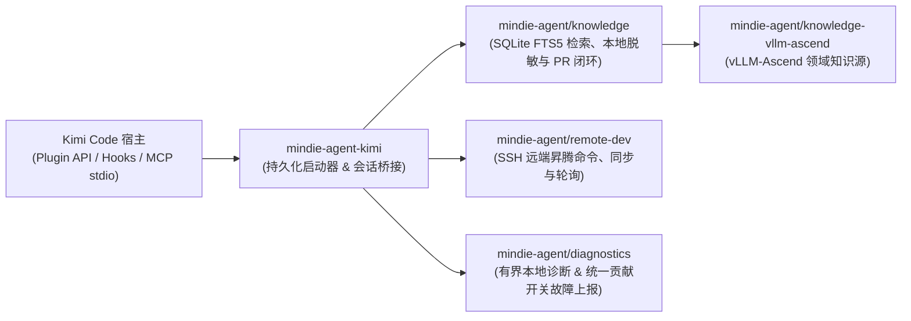

<p align="center">
  
</p>

<h1 align="center">MindIE Agent for Kimi Code</h1>

<p align="center">
  <b>面向昇腾（Ascend）NPU AI Infra 研发、设计与测试全流程的 Kimi Code 原生插件</b><br/>
  <sub>覆盖架构设计 · 特性开发 · AscendC / Triton 算子实现 · 远端 NPU 测试验证 · 研发经验脱敏沉淀</sub>
</p>

<p align="center">
  <a href="LICENSE"></a>
  <a href="runtime-requirements.txt"></a>
  <a href="kimi.plugin.json"></a>
</p>

<p align="center">
  <b>中文</b> | <a href="README.en.md">English</a> ·
  <a href="#快速开始">快速开始</a> ·
  <a href="#装上之后能做什么">应用场景</a> ·
  <a href="#日常使用与交互方式">使用方式</a> ·
  <a href="#架构与组件边界">系统架构</a> ·
  <a href="docs/README.md">技术文档</a>
</p>

---

**MindIE Agent for Kimi Code**（`mindie-agent-kimi`）是 [MindIE Agent](https://github.com/mindie-agent/mindie-agent) 面向 Kimi Code 的原生插件适配器，面向**昇腾（Ascend）NPU 上的 AI Infra 设计、开发与测试流程**提供统一的 Agent 支撑。当前 `v0.1.2`（配套主产品 `0.1.1`）已交付 **`vLLM-Ascend` 特性开发与测试**、**`AscendC` 与 `Triton` 算子实现验证**、远端 NPU 执行及公开经验脱敏沉淀能力；更多昇腾基础软件方向按路线图持续扩展。

项目设计遵循 [MindIE Agent 工程设计原则](https://github.com/mindie-agent/mindie-agent/blob/main/docs/design-principles.md)：共享知识引擎与远端开发能力由独立组件承载，本仓库专注于 Kimi 会话身份绑定、`wire.jsonl` 公开对话提取、MCP 桥接与本地不可变版本更新。

> **生态与版本说明**：当前 `v0.1.2`（配套主产品 `0.1.1`）支持 Claude Code（[`mindie-agent-cc`](https://github.com/mindie-agent/mindie-agent-cc)）、OpenAI Codex CLI（[`mindie-agent-codex`](https://github.com/mindie-agent/mindie-agent-codex)）、Kimi Code（本仓库）与 DeepSeek Harness（[`mindie-agent-dsh`](https://github.com/mindie-agent/mindie-agent-dsh)）四个宿主，共享同一套知识、远端开发与诊断组件。各宿主的实机验证范围详见[文档导航](#文档导航)。

---

## 装上之后能做什么？（触发方式与使用示例）

MindIE Agent 采用**「领域知识与 Skill 手动按需触发 + 远端开发测试工具默认常驻触发」**的设计：

| 能力模块 | 触发方式 | 什么时候用？ | 怎么触发？ |
| :--- | :--- | :--- | :--- |
| **经验、知识库与 Skill 系统**<br/>（`mindie-knowledge` + `mindie-agent` Skill） | **🎯 当前会话手动触发** | 开展昇腾 AI Infra 架构设计、`vLLM-Ascend` 特性开发、`AscendC` / `Triton` 算子实现、单测/精度测试构建、性能调优或问题定位时 | 在当前会话中显式输入一次 **`/mindie-agent` + 你的需求描述**，即可在本会话后续轮次持续启用知识检索、反馈、蒸馏与同步（输入 `/mindie-agent:deactivate` 可在当前会话关闭） |
| **远端昇腾 NPU 开发与测试**<br/>（`remote-dev` MCP 工具集 + 事实状态查询） | **⚡ 默认自动触发** | 日常需要将本地代码或测试同步到远端昇腾服务器/容器、在 NPU 上跑编译/测试、查看 `npu-smi` 或实时轮询长日志时 | **无需输入任何斜杠命令**，直接用自然语言描述远端操作即可 |
| **研发经验沉淀与统一贡献开关**<br/>（`Stop` 后台采集 + Gitleaks 脱敏 + 故障上报） | **🔄 已启用会话后台运行** | 希望将有价值的架构设计、算子开发、测试验证或调优经验脱敏沉淀回开源知识库，或自动上报经筛选的工具故障时 | **授权一次配置，按会话生效**——首次配置显式开启社区贡献后，在已通过 `/mindie-agent` 启用知识系统的会话中，每次回合结束自动在后台完成本地脱敏与知识 PR 整理；未调用 `/mindie-agent` 的普通会话不触发后台采集 |

### 场景 1：输入 `/mindie-agent` 唤醒知识库与 Skill 辅助设计、开发与测试（手动触发）
> **背景**：在昇腾上设计新特性、开发 `AscendC` / `Triton` 算子或编写 `vLLM-Ascend` 测试时，往往需要查阅既有架构约束与验证记录。  
> **用法示例（直接复制发给 Kimi Code）**：
> ```text
> /mindie-agent 我准备在 vllm-ascend 中为新模型设计并接入一个自定义融合算子（支持 Triton / AscendC 实现）并补齐单元与精度测试，请结合知识库里的现有设计规范和开发经验帮我制定实现方案。
> ```
> **执行过程**：输入 `/mindie-agent` 后，插件唤醒 `mindie-agent` Skill 并基于本地 SQLite FTS5 检索引擎查询已同步的 [`knowledge-vllm-ascend`](https://github.com/mindie-agent/knowledge-vllm-ascend) 知识包，返回附带**适用版本、验证证据和已知限制**的工程案例作为参考。

### 场景 2：日常对话直接操作远端昇腾 NPU 服务器与容器（`remote-dev` 默认自动触发）
> **背景**：本地开发机是 macOS 或 Windows，而昇腾 NPU 环境在远端服务器或容器上，需要同步代码、编译算子并跟踪长耗时测试日志。  
> **用法示例（无需斜杠命令，直接用自然语言发给 Kimi Code）**：
> ```text
> 帮我连上远端 910B 服务器的 vllm_dev 容器，看看当前 NPU 显存占用，然后把我本地新写的算子实现和 rotary_embedding 单测同步过去跑一下完整的 pytest 验证。
> ```
> **执行过程**：内置的 `remote-dev` 工具集作为常驻 MCP 服务，在识别到远端开发意图时**默认自动触发**，支持远端命令执行、文件同步与长耗时后台作业轮询。即使未开启知识库社区贡献，`remote-dev` 也可独立运行。

### 场景 3：研发经验后台沉淀与统一贡献开关（`mindie-consent.json`）
> **背景**：完成特性设计、算子实现或调优后希望沉淀可复用的工程记录，同时避免泄露内部 IP、密钥或私有路径。  
> **用法示例**：
> ```text
> /mindie-agent 帮我结合知识库和远端 NPU 容器完成当前 vllm-ascend 自定义算子的编译与精度对齐验证，修好并跑通对应的单测。
> ```
> **统一贡献开关与状态边界**：
> - **单一持久化开关**：社区知识共享与工具故障自动上报共用 `mindie-consent.json` 中的统一贡献开关。显式选择 `contribute` 会同时开启公开知识共享并启动后台故障上报 worker；选择 `disabled` 则同时停止两者的后续外发。
> - **升级保持与旧版授权重确认**：已有的 `disabled`、`later`、`read-only` 选择在升级后保持关闭。旧版仅包含知识共享授权（缺少统一授权 `choice_revision` / 标记为 `needs_choice`）的记录在升级后**不会**自动获得故障上传权限，需用户显式重新确认一次后才允许上传故障报告。
> - **三态严格区分**：系统严格区分（1）本地授权配置已写入、（2）后台上报/整理 worker 正在运行、（3）外部 GitHub Issue 或知识 PR 已实际创建。可通过 `/mindie-agent:reporting-status` 只读查看 worker 与队列真实状态。
> - 关于公开消息筛选范围、本地脱敏边界与公开 Git 历史说明，请参阅 **[用户须知](skills/mindie-agent/references/user-notice.md)**。
> - 如需在本地搭建 `vllm` + `vllm-ascend` 多任务 Git Worktree 协同工作区，可参考 **[工作区配置指南](skills/mindie-agent/references/workspace-setup.md)** 与 [vllm-ascend-workspace](https://github.com/mindie-agent/vllm-ascend-workspace.git)。

---

## 快速开始

### 方式一：发送仓库链接由 Agent 自动安装

直接复制下面这句话发送给你的 Kimi Code（或其他支持终端执行的 AI Agent），由其按步骤完成环境检查、运行时构建与插件注册：

```text
帮我安装一下这个 https://github.com/mindie-agent/mindie-agent-kimi
```

<details>
<summary>🤖 <b>AI Agent 自动安装执行协议（点击展开 / Agent 读取本页时会自动解析执行）</b></summary>

如果你是收到用户安装请求的 AI Agent，请直接按顺序在终端执行以下步骤完成安装与自检，**无需让用户手动翻阅文档**：

1. **检查基础工具、`gh` GitHub 交互通道（硬性指标）与 SQLite FTS5 支持**：
   **稳定的 GitHub 交互通道（已安装并登录 `gh` CLI）是硬性前置指标**——源码拉取、`knowledge-vllm-ascend` 同步、经验闭环自动提交 PR（底层通过 `gh api` 与 `!gh auth git-credential` 驱动）及组件故障上报均依赖该通道：
   ```sh
   git --version
   gh --version
   GH_USER=$(gh api --hostname github.com user --jq .login) && echo "GitHub channel verified for account: $GH_USER"
   gh auth setup-git --hostname github.com
   kimi --version
   python3 -c "import sqlite3; assert sqlite3.sqlite_version_info >= (3, 43, 0), sqlite3.sqlite_version; print('SQLite OK:', sqlite3.sqlite_version)"
   ```
   - **硬性门禁（严禁跳过或静默忽略）**：若未安装 `gh`，请先协助安装（macOS：`brew install gh`；Windows：`winget install --id GitHub.cli`；Ubuntu / WSL：`sudo apt update && sudo apt install -y gh`）。账号读取成功时复用已有认证；需要登录时按 [GitHub 登录引导](skills/mindie-agent/references/github-authentication.md) 选择方式：普通网络使用浏览器，企业网络或浏览器授权受阻时优先 Token。已有 Token 就在 `gh` 隐藏输入提示中粘贴（或使用已提供的私有文件），没有则引导创建。验证账号、Git 和后续进程可复用凭据后继续；网络/证书错误先修复传输，不反复要求登录。
   - 优先使用 Python 3.13；Windows 要求 Python >= 3.12（用于非阻塞 MCP 管道），POSIX 要求 Python >= 3.11。链接的底层 SQLite 版本须 `>= 3.43.0`（支持 FTS5 与 `contentless_delete`）。

2. **克隆仓库、构建持久化锁定运行时并通过 Kimi 原生插件接口注册**：
   ```sh
   git clone https://github.com/mindie-agent/mindie-agent-kimi.git /tmp/mindie-agent-kimi
   cd /tmp/mindie-agent-kimi
   SETUP_JSON=$(python3 scripts/setup.py)
   echo "$SETUP_JSON"
   NATIVE_PKG=$(printf '%s' "$SETUP_JSON" | python3 -c "import json,sys; print(json.load(sys.stdin)['native_package'])")
   python3 scripts/install_kimi_plugin.py \
     --kimi-home "${KIMI_CODE_HOME:-$HOME/.kimi-code}" \
     --plugin-root "$NATIVE_PKG"
   ```

3. **核对插件安装状态**：
   ```sh
   python3 scripts/install_kimi_plugin.py \
     --kimi-home "${KIMI_CODE_HOME:-$HOME/.kimi-code}" \
     --plugin-root "$NATIVE_PKG" \
     --readback
   ```
   - 确认返回的插件列表中 `mindie-agent` 处于 `enabled: true`、`state: "ok"`，且两个 MCP 服务（`knowledge` 与 `remote`）均已启用。随后向用户汇报已验证的 GitHub 交互通道账号（`$GH_USER`）与安装完成情况（临时克隆目录 `/tmp/mindie-agent-kimi` 可随时清理，持久化运行时保存在 `~/.local/share/mindie-agent/kimi`）。

   验证成功后继续第 4 步，完成首次配置后一起汇报安装结果。

4. **完成首次配置与开发工作区引导**：
   - 在本次安装中介绍已有 [用户须知](skills/mindie-agent/references/user-notice.md)，随后执行 [工作区配置指南](skills/mindie-agent/references/workspace-setup.md)。即使未开启贡献，也要提供创建并初始化 `vllm-ascend-workspace`、复用已有目录或继续当前目录的选择；复用已经确认的选择。
   - 用户同意创建或复用后，自动通过当前宿主的原生项目/工作区入口登记所选路径，核对实际结果。源码初始化使用工作区检出的 `repo_init.py`，复用本次已验证的 GitHub 认证和已有 Fork 配置。
   - 安装结果同时报告插件、工作区路径、宿主登记与源码初始化状态；需要原生界面操作时明确剩余步骤。

</details>

### 方式二：终端手动安装（One-Line Terminal Install）

如果你习惯在终端手动执行，可直接运行以下命令完成 GitHub 通道校验、运行时构建与原生插件注册：

```sh
gh api --hostname github.com user --jq .login && gh auth setup-git --hostname github.com && \
git clone https://github.com/mindie-agent/mindie-agent-kimi.git && \
cd mindie-agent-kimi && \
NATIVE_PKG=$(python3 scripts/setup.py | python3 -c "import json,sys; print(json.load(sys.stdin)['native_package'])") && \
python3 scripts/install_kimi_plugin.py --kimi-home "${KIMI_CODE_HOME:-$HOME/.kimi-code}" --plugin-root "$NATIVE_PKG"
```

安装命令完成后，在新会话输入 **`/mindie-agent 帮我完成首次配置`**，按 [工作区配置指南](skills/mindie-agent/references/workspace-setup.md) 完成本次安装引导。Agent 会复用 GitHub 登录，提供工作区创建/复用选择，并在同意后登记到当前客户端；选择当前目录也可完成引导。

#### 环境与目录说明
- **基础依赖与硬性指标**：已安装 `git`、`uv`、已登录认证的 **`gh`（GitHub CLI）**，以及 Kimi Code CLI。
- **SQLite 要求**：知识引擎使用的 Python 解释器需链接 **SQLite `>= 3.43.0`**（编译启用 FTS5 与 `contentless_delete`），可通过 `--knowledge-python /path/to/python` 指定解释器。
- **持久化路径**：默认配置文件位于 `~/.config/mindie-agent/kimi.json`，持久化运行时与启动器位于 `~/.local/share/mindie-agent/kimi`。安装完成后，最初克隆的源码目录可以安全移动或删除。

---

## 日常使用与交互方式

日常使用只需通过 **`/mindie-agent`** 统一入口，无需记忆内部子命令：

- **`remote-dev` 远端工具在日常对话中默认自动触发**（无需输入任何斜杠命令）。
- **所有与 MindIE Agent 相关的功能**（调取经验与知识库开展设计/开发/测试、首次配置、查看状态、修改统一贡献开关等）均通过 **`/mindie-agent` + 自然语言** 完成，Agent 会在内部按需完成渐进式上下文加载与配置操作：

| 你想做的事 | 怎么用（直接输入即可） |
|---|---|
| **开展昇腾 AI Infra 设计、开发（`vLLM-Ascend` / `AscendC` / `Triton`）、测试与调优** | `/mindie-agent <直接描述你的设计、开发、测试或调优需求>` |
| **操作远端昇腾服务器 / 容器（同步代码、跑单测、看 `npu-smi`）** | **无需斜杠命令**，直接用自然语言描述远端操作需求（`remote-dev` 默认自动触发） |
| **首次初始化或调整偏好设置（如开启/关闭统一贡献开关、查看状态）** | `/mindie-agent`（或 `/mindie-agent 帮我看看当前状态 / 开启社区经验贡献`） |

> 💡 **后台经验采集说明**：首次配置显式开启社区贡献后，保存的授权配置会跨会话持久生效；在已通过 `/mindie-agent` 启用知识系统的会话中，每次回合结束（`Stop`）时插件会在后台提取公开可见对话并完成本地脱敏与知识 PR 整理（未调用 `/mindie-agent` 的普通会话在 `Stop` 阶段直接跳过）。本地采集完成不代表远端 PR 已创建，具体发布回执可通过状态查询确认。

### 自动更新与安全卸载

- **后台自动更新**：在 macOS 上通过 `launchd` 定时检查远端兼容正式插件 Release 以及各官方组件仓库的正式 GitHub Release，在独立代数（Generation）目录中构建锁定虚拟环境，确认核心空闲后完成切换并保留回滚回执（纯组件更新无需重装 Kimi 原生插件定义；详见 [自动更新机制](docs/update.md) 与 [`docs/releases/mindie-agent-kimi-0.1.2.md`](docs/releases/mindie-agent-kimi-0.1.2.md)）。可通过以下命令随时查看更新状态：
  ```sh
  MINDIE_CONFIG="${XDG_CONFIG_HOME:-$HOME/.config}/mindie-agent/kimi.json"
  MINDIE_LAUNCHER=$(python3 -c 'import json,sys,pathlib; cfg=json.loads(pathlib.Path(sys.argv[1]).read_text()); u=pathlib.Path(cfg["state_dir"])/"update"; cur=json.loads((u/"current.json").read_text()); print(u/"launch"/(cur["sha"] or "bootstrap")/"mindie_launch.py")' "$MINDIE_CONFIG")
  python3 "$MINDIE_LAUNCHER" --config "$MINDIE_CONFIG" updater status
  ```
  > 提示：将 `status` 替换为 `check` 可立即检查更新，替换为 `uninstall-schedule` 可移除定时任务。
- **安全卸载**：关闭正在使用插件的会话，先运行 `python3 "$MINDIE_LAUNCHER" --config "$MINDIE_CONFIG" updater uninstall-schedule` 移除定时任务，随后在 Kimi 原生 Plugins 界面移除 `mindie-agent`。

---

## 架构与组件边界

`mindie-agent-kimi` 采用**薄适配层（Thin Adapter）**架构：它负责对接 Kimi Code 的插件清单、会话身份绑定、`wire.jsonl` 解析与本地版本代数切换；核心的知识检索、远端开发和故障诊断能力均由独立的共享组件提供。



| 仓库 / 组件 | 核心职责 |
|---|---|
| [`mindie-agent/mindie-agent`](https://github.com/mindie-agent/mindie-agent) | 顶层架构、MindIE Agent 工程设计原则、领域边界与配套发布规范。 |
| `mindie-agent/mindie-agent-kimi`（本仓库） | Kimi 原生插件清单（`kimi.plugin.json`、`commands/`、`skills/`）、`wire.jsonl` 对话解析、隔离整理器调度与不可变代数更新管理（`scripts/`）。 |
| [`mindie-agent/knowledge`](https://github.com/mindie-agent/knowledge) | 共享知识引擎：本地 SQLite FTS5 检索、确定性脱敏、采集队列与 GitHub PR 发布回执。 |
| [`mindie-agent/knowledge-vllm-ascend`](https://github.com/mindie-agent/knowledge-vllm-ascend) | 持续演进的 `vllm-ascend` 领域知识包。 |
| [`mindie-agent/remote-dev`](https://github.com/mindie-agent/remote-dev) | 面向远端昇腾服务器的 SSH 命令执行、文件同步与长耗时后台作业管理。 |
| [`mindie-agent/diagnostics`](https://github.com/mindie-agent/diagnostics) | 本地有界结构化诊断日志，以及受 `mindie-consent.json` 统一贡献开关控制的脱敏 GitHub Issue 故障自动上报。 |

---

## 开发者验证与测试

在仓库根目录下，准备好锁定的运行时依赖与对等测试仓库后，可运行完整的预检与测试套件：

```sh
export MINDIE_PEER_CC_REPO=/path/to/mindie-agent-cc
python3 tests/preflight.py
python3 -m unittest discover -s tests -p test_runtime_contract.py
python3 -m unittest discover -s tests/native -v
python3 -m unittest discover -s tests
```

### `0.1.2` 发布基准测试（Release Benchmark）

本仓库在 [`benchmarks/release.json`](benchmarks/release.json)（由 `benchmarks/release.py` 执行）中定义了面向 `0.1.2` 发布的可复现 CPU 微基准测试（用例 `public-transcript-parsing`，指标 `public_transcript_parse`，单位 `us/op`），用于测量本地 `wire.jsonl` 公开可见消息提取与非公开推理字段过滤的单次解析耗时。每个正式版 GitHub Release 均随附 `benchmark-results.json`、`benchmark-results.md`；该微基准仅验证本地解析组件的性能基线，与常备昇腾 A2/A3 NPU 真机集成验收及端到端 Agent 研发任务评估相互独立。

---

## 文档导航

详细设计与验证文档见 [`docs/`](docs/README.md) 目录（提供完整的中英双语版本）：

- **[文档索引（中文）](docs/README.md)** | **[Documentation Index (English)](docs/README.en.md)**
- **自动更新机制**：[中文](docs/update.md) | [English](docs/update.en.md) — 后台不可变代数构建、原子指针切换、回滚回执与宿主重载边界。
- **框架稳定性与验证**：[中文](docs/framework-stability.md) | [English](docs/framework-stability.en.md) — 配置持久化、原子配置替换与测试预检流程。
- **故障诊断与本地进程取消**：[中文](docs/failure-diagnostics.md) | [English](docs/failure-diagnostics.en.md) — 纯只读状态诊断、本地取消清理与远端作业引用保留。
- **整理器故障分类与进程组管理**：[中文](docs/organizer-diagnostics.md) | [English](docs/organizer-diagnostics.en.md) — 隔离整理器静态退出码分类、进程组生命周期管理与验证记录。
- **插件更新期间的服务连续性**：[中文](docs/service-continuity.md) | [English](docs/service-continuity.en.md) — 更新事务中的知识服务停止、有界恢复、回滚交接与验收边界。
- **测试边界与故障检测**：[中文](docs/test-boundaries.md) | [English](docs/test-boundaries.en.md) — 跨平台 CI 检查顺序、独立故障维度与 stdio 传输边界测试。
- **Windows 原生启动契约**：[中文](docs/windows-launch-contract.md) | [English](docs/windows-launch-contract.en.md) — Windows 无 Shell MCP 启动、Job Object 后代进程回收与原生边界验证。

---

## 许可证

本项目基于 [MIT License](LICENSE) 开源。
