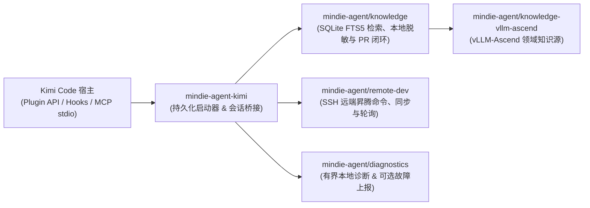

<p align="center">
  
</p>

<h1 align="center">MindIE Agent for Kimi Code</h1>

<p align="center">
  <b>面向昇腾（Ascend）推理与算子工程的 Kimi Code 原生插件</b><br/>
  <sub>按需领域知识检索 · SSH 远端 NPU 开发调试 · 隐私受控的经验沉淀闭环</sub>
</p>

<p align="center">
  <a href="LICENSE"></a>
  <a href="runtime-requirements.txt"></a>
  <a href="kimi.plugin.json"></a>
</p>

<p align="center">
  <b>中文</b> | <a href="README.en.md">English</a> ·
  <a href="#快速开始">快速开始</a> ·
  <a href="#装上之后能做什么">应用场景</a> ·
  <a href="#日常使用与命令参考">命令参考</a> ·
  <a href="#架构与组件边界">系统架构</a> ·
  <a href="docs/README.md">技术文档</a>
</p>

---

**MindIE Agent for Kimi Code**（`mindie-agent-kimi`）是 [MindIE Agent](https://github.com/mindie-agent/mindie-agent) 面向 Kimi Code 打造的原生插件适配器。它把 **`vLLM-Ascend` 领域知识检索**、**SSH 远端昇腾 NPU 开发调试**以及**隐私受控的本地经验闭环**直接融入你的 Kimi Code 日常研发流中。

项目设计遵循 [MindIE Agent 工程设计原则](https://github.com/mindie-agent/mindie-agent/blob/main/docs/design-principles.md)：共享知识引擎与远端开发能力由独立组件承载，本仓库专注于 Kimi 会话身份绑定、`wire.jsonl` 公开对话提取、MCP 桥接与本地不可变版本更新。

> **生态与版本说明**：MindIE Agent 首个正式产品版本（`v0.0.1`）优先面向 Codex（[`mindie-agent-codex`](https://github.com/mindie-agent/mindie-agent-codex)）与 Claude Code（[`mindie-agent-cc`](https://github.com/mindie-agent/mindie-agent-cc)）发布；`mindie-agent-kimi` 作为生态中的实验性源码安装（Source-Installed）适配器持续维护，验证范围详见[文档导航](#文档导航)。

---

## 装上之后能做什么？（触发方式与使用示例）

MindIE Agent 采用**「知识与 Skill 手动按需触发 + 远端执行工具默认常驻触发」**的双模式设计：

| 能力模块 | 触发方式 | 什么时候用？ | 怎么触发？ |
| :--- | :--- | :--- | :--- |
| **经验、知识库与 Skill 系统**<br/>（`mindie-knowledge` + `mindie-agent` Skill） | **🎯 手动触发** | 遇到昇腾 / `vLLM-Ascend` 报错排障、算子适配、图模式编译异常、精度/性能调优，需要调取历史踩坑经验、领域知识库与专业 Skill 引导时 | 在输入框中显式输入 **`/mindie-agent` + 你的问题描述** |
| **远端昇腾 NPU 开发与执行**<br/>（`remote-dev` MCP 工具集） | **⚡ 默认自动触发** | 日常需要将本地改动同步到远端昇腾服务器/容器、在 NPU 上跑编译/测试、查看 `npu-smi` 或实时轮询长日志时 | **无需输入任何斜杠命令**，直接用自然语言描述远端操作即可 |

### 场景 1：输入 `/mindie-agent` 唤醒经验、知识库与 Skill 排障（手动触发）
> **痛点**：遇到 `HCCL` 通信超时、`ACL` 算子报错、图模式（Graph Mode）编译异常或精度问题时，在零散的 Issue 和群聊记录中大海捞针非常耗时。  
> **用法示例（直接复制发给 Kimi Code）**：
> ```text
> /mindie-agent 我在 8 卡 910B 上用 vllm-ascend 跑 DeepSeek-R1 推理时遇到 HCCL AllReduce timeout (hcclRet=4)，CANN 是 8.0.RC3，请结合历史经验帮我排查根因。
> ```
> **会发生什么**：输入 `/mindie-agent` 后，插件会唤醒 `mindie-agent` Skill 并基于本地 SQLite FTS5 检索引擎查询已同步的 [`knowledge-vllm-ascend`](https://github.com/mindie-agent/knowledge-vllm-ascend) 知识包，返回附带**适用版本、验证证据和已知限制**的工程排障案例作为参考，不强制规定你的排障路线。

### 场景 2：日常对话直接操作远端昇腾 NPU 服务器与容器（`remote-dev` 默认自动触发）
> **痛点**：本地开发机是 Mac 或 Windows 笔记本，而昇腾 NPU 环境在远端服务器或容器上，频繁手动同步补丁、盯长耗时测试日志极其繁琐。  
> **用法示例（无需斜杠命令，直接用自然语言发给 Kimi Code）**：
> ```text
> 帮我连上远端 910B 服务器的 vllm_dev 容器，看看当前 NPU 显存占用，然后把我本地改好的 rotary_embedding.py 同步过去跑一下对应的 pytest 单测。
> ```
> **会发生什么**：内置的 `remote-dev` 工具集作为常驻 MCP 服务，会在识别到远端开发意图时**默认自动触发**，支持远端命令执行、文件同步与长耗时后台作业轮询。即使不开启知识库服务或社区贡献，`remote-dev` 也能完全独立运行。

### 场景 3：唤醒 `/mindie-agent` 攻坚并沉淀脱敏经验回开源社区（可选 Opt-in）
> **痛点**：花半天定位完一个棘手的算子或推理 Bug，关掉终端后排障思路就丢了；想分享给社区又担心泄露内部 IP、密钥或私有路径。  
> **用法示例（直接复制发给 Kimi Code）**：
> ```text
> /mindie-agent 帮我结合知识库和远端 NPU 容器定位一下当前 vllm-ascend 自定义算子编译失败的问题，修好跑通单测后我们把这次排障经验沉淀下来。
> ```
> **会发生什么**：社区贡献**默认关闭**。仅在你显式对指定公开仓库开启共享后，插件会在会话结束（`Stop`）时提取公开可见对话，使用本地确定性规则与 Gitleaks 完成脱敏，并通过隔离的整理器生成标题与摘要以提交知识 PR。
> - 关于公开消息筛选范围、本地脱敏边界与公开 Git 历史说明，请参阅 **[用户须知](skills/mindie-agent/references/user-notice.md)**。
> - 如需在本地搭建 `vllm` + `vllm-ascend` 多任务 Git Worktree 协同工作区，可按需参考 **[工作区配置指南](skills/mindie-agent/references/workspace-setup.md)** 与 [vllm-ascend-workspace](https://github.com/mindie-agent/vllm-ascend-workspace.git)。

---

## 快速开始

### 方式一：直接把链接发给你的 Agent 自动安装（推荐）

直接复制下面这句话发送给你的 Kimi Code（或其他支持终端执行的 AI Agent），让它自动帮你完成环境检查、运行时构建与插件注册：

```text
帮我安装一下这个 https://github.com/mindie-agent/mindie-agent-kimi
```

<details open>
<summary>🤖 <b>AI Agent 自动安装执行协议（Instructions for AI Agents）</b></summary>

如果你是收到用户安装请求的 AI Agent，请直接按顺序在终端执行以下步骤完成安装与自检，**无需让用户手动翻阅文档**：

1. **检查基础工具与 SQLite FTS5 支持**：
   ```sh
   git --version
   kimi --version
   python3 -c "import sqlite3; assert sqlite3.sqlite_version_info >= (3, 43, 0), sqlite3.sqlite_version; print('SQLite OK:', sqlite3.sqlite_version)"
   ```
   - 确认 Python >= 3.11，且链接的底层 SQLite 版本 `>= 3.43.0`（支持 FTS5 与 `contentless_delete`）。

2. **克隆仓库、构建持久化锁定运行时并通过 Kimi 原生插件接口注册**：
   ```sh
   git clone https://github.com/mindie-agent/mindie-agent-kimi.git /tmp/mindie-agent-kimi
   cd /tmp/mindie-agent-kimi
   SETUP_JSON=$(python3 scripts/setup.py)
   echo "$SETUP_JSON"
   NATIVE_PKG=$(printf '%s' "$SETUP_JSON" | python3 -c "import json,sys; print(json.load(sys.stdin)['native_package'])")
   python3 scripts/install_kimi_plugin.py \
     --kimi-home "${KIMI_CODE_HOME:-$HOME/.kimi-code}" \
     --plugin-root "$NATIVE_PKG"
   ```

3. **校验原生安装回读结果并向用户汇报**：
   ```sh
   python3 scripts/install_kimi_plugin.py \
     --kimi-home "${KIMI_CODE_HOME:-$HOME/.kimi-code}" \
     --plugin-root "$NATIVE_PKG" \
     --readback
   ```
   - 确认返回的插件列表中 `mindie-agent` 处于 `enabled: true`、`state: "ok"`，且两个 MCP 服务（`knowledge` 与 `remote`）均已启用。随后告知用户安装已完成（临时克隆目录 `/tmp/mindie-agent-kimi` 可随时清理，持久化运行时保存在 `~/.local/share/mindie-agent/kimi`）。

</details>

### 方式二：终端手动一行安装（One-Line Terminal Install）

如果你习惯在终端手动执行，可直接运行以下命令完成克隆、运行时构建与原生插件注册：

```sh
git clone https://github.com/mindie-agent/mindie-agent-kimi.git && \
cd mindie-agent-kimi && \
NATIVE_PKG=$(python3 scripts/setup.py | python3 -c "import json,sys; print(json.load(sys.stdin)['native_package'])") && \
python3 scripts/install_kimi_plugin.py --kimi-home "${KIMI_CODE_HOME:-$HOME/.kimi-code}" --plugin-root "$NATIVE_PKG"
```

#### 环境与目录说明
- **SQLite 要求**：知识引擎使用的 Python 解释器需链接 **SQLite `>= 3.43.0`**（编译启用 FTS5 与 `contentless_delete`），可通过 `--knowledge-python /path/to/python` 指定解释器。
- **持久化路径**：默认配置文件位于 `~/.config/mindie-agent/kimi.json`，持久化运行时与启动器位于 `~/.local/share/mindie-agent/kimi`。安装完成后，最初克隆的源码目录可以安全移动或删除。

---

## 日常使用与命令参考

在 Kimi Code 会话中，**`remote-dev` 远端工具在日常对话中默认自动触发**。当你需要唤醒昇腾历史经验、领域知识库与 Skill 系统，或修改偏好设置时，可使用以下斜杠命令：

| Kimi Code 命令 | 用途说明 |
|---|---|
| `/mindie-agent <问题描述>`（或 `/skill:mindie-agent`、`/mindie-agent:init`、`/init`） | **手动触发入口**：输入 `/mindie-agent` 并阐述问题即可唤醒昇腾领域知识库、历史经验与 Skill 系统（同时绑定当前原生 Kimi 任务并确保后台知识服务就绪）。 |
| `/mindie-agent:status`（或 `/status`） | **纯只读状态检查**：查看当前任务的知识库配置、后台服务健康度以及最近 5 条采集与贡献批次状态（不启动模型或初始化数据库）。 |
| `/mindie-agent contribute owner/repo ACCOUNT` | 为当前项目显式配置公开知识贡献的目标仓库与 GitHub 账号。 |
| `/mindie-agent:sharing-enable` / `/mindie-agent:sharing-disable` / `/mindie-agent:sharing-status` | 开启、暂停或查看当前项目的公开社区贡献（关闭后 `Stop` 阶段不采集对话、不调用整理器）。 |
| `/mindie-agent:deactivate`（或 `/deactivate`） | 解除当前会话任务的知识访问绑定（保留全局共享与故障上报设置）。 |
| `/mindie-agent:recover`（或 `/recover`） | 按 `--batch <id>` 检查或恢复指定贡献批次（常规临时网络波动由后台 Worker 自动恢复）。 |
| `/mindie-agent:reporting-status` / `/mindie-agent:reporting-enable` / `/mindie-agent:reporting-disable` | 查看、开启或关闭独立的产品自身故障脱敏上报（开启后会返回一条一次性终端准备命令）。 |

### 自动更新与安全卸载

- **后台自动更新**：在 macOS 上通过 `launchd` 每 5 分钟自动检查一次远端 `main` 分支，在独立代数（Generation）目录中构建锁定虚拟环境，确认核心空闲后通过 Kimi 原生插件接口完成切换并保留回滚回执（详见 [自动更新机制](docs/update.md)）。可通过以下命令随时查看更新状态：
  ```sh
  MINDIE_CONFIG="${XDG_CONFIG_HOME:-$HOME/.config}/mindie-agent/kimi.json"
  MINDIE_LAUNCHER=$(python3 -c 'import json,sys,pathlib; cfg=json.loads(pathlib.Path(sys.argv[1]).read_text()); u=pathlib.Path(cfg["state_dir"])/"update"; cur=json.loads((u/"current.json").read_text()); print(u/"launch"/(cur["sha"] or "bootstrap")/"mindie_launch.py")' "$MINDIE_CONFIG")
  python3 "$MINDIE_LAUNCHER" --config "$MINDIE_CONFIG" updater status
  ```
  > 提示：将 `status` 替换为 `check` 可立即检查更新，替换为 `uninstall-schedule` 可移除定时任务。
- **安全卸载**：关闭正在使用插件的会话，先运行 `python3 "$MINDIE_LAUNCHER" --config "$MINDIE_CONFIG" updater uninstall-schedule` 移除定时任务，随后在 Kimi 原生 Plugins 界面移除 `mindie-agent`。

---

## 架构与组件边界

`mindie-agent-kimi` 采用**薄适配层（Thin Adapter）**架构：它负责对接 Kimi Code 的插件清单、会话身份绑定、`wire.jsonl` 解析与本地版本代数切换；核心的知识检索、远端开发和故障诊断能力均由独立的共享组件提供。



| 仓库 / 组件 | 核心职责 |
|---|---|
| [`mindie-agent/mindie-agent`](https://github.com/mindie-agent/mindie-agent) | 顶层架构、MindIE Agent 工程设计原则、领域边界与配套发布规范。 |
| `mindie-agent/mindie-agent-kimi`（本仓库） | Kimi 原生插件清单（`kimi.plugin.json`、`commands/`、`skills/`）、`wire.jsonl` 对话解析、隔离整理器调度与不可变代数更新管理（`scripts/`）。 |
| [`mindie-agent/knowledge`](https://github.com/mindie-agent/knowledge) | 共享知识引擎：本地 SQLite FTS5 检索、确定性脱敏、采集队列與 GitHub PR 发布回执。 |
| [`mindie-agent/knowledge-vllm-ascend`](https://github.com/mindie-agent/knowledge-vllm-ascend) | 持续演进的 `vllm-ascend` 领域知识包。 |
| [`mindie-agent/remote-dev`](https://github.com/mindie-agent/remote-dev) | 面向远端昇腾服务器的 SSH 命令执行、文件同步与长耗时后台作业管理。 |
| [`mindie-agent/diagnostics`](https://github.com/mindie-agent/diagnostics) | 本地有界结构化诊断日志与可选的脱敏 GitHub Issue 自动上报。 |

---

## 开发者验证与测试

在仓库根目录下，准备好锁定的运行时依赖与对等测试仓库后，可运行完整的预检与测试套件：

```sh
export MINDIE_PEER_CC_REPO=/path/to/mindie-agent-cc
python3 tests/preflight.py
python3 -m unittest discover -s tests -p test_runtime_contract.py
python3 -m unittest discover -s tests/native -v
python3 -m unittest discover -s tests
```

---

## 文档导航

详细设计与验证文档见 [`docs/`](docs/README.md) 目录（提供完整的中英双语版本）：

- **[文档索引（中文）](docs/README.md)** | **[Documentation Index (English)](docs/README.en.md)**
- **自动更新机制**：[中文](docs/update.md) | [English](docs/update.en.md) — 后台不可变代数构建、原子指针切换、回滚回执与宿主重载边界。
- **框架稳定性与验证**：[中文](docs/framework-stability.md) | [English](docs/framework-stability.en.md) — 日常无感使用保障、Windows 原子配置读写与测试预检流程。
- **故障诊断与本地进程取消**：[中文](docs/failure-diagnostics.md) | [English](docs/failure-diagnostics.en.md) — 纯只读状态诊断、本地取消清理与远端作业引用保留。
- **整理器故障分类与进程组管理**：[中文](docs/organizer-diagnostics.md) | [English](docs/organizer-diagnostics.en.md) — 隔离整理器静态退出码分类、进程组生命周期管理与验证记录。
- **插件更新期间的服务连续性**：[中文](docs/service-continuity.md) | [English](docs/service-continuity.en.md) — 更新事务中的知识服务停止、有界恢复、回滚交接与验收边界。
- **测试边界与故障检测**：[中文](docs/test-boundaries.md) | [English](docs/test-boundaries.en.md) — 跨平台 CI 检查顺序、独立故障维度与 stdio 传输边界测试。
- **Windows 原生启动契约**：[中文](docs/windows-launch-contract.md) | [English](docs/windows-launch-contract.en.md) — Windows 无 Shell MCP 启动、Job Object 后代进程回收与原生边界验证。

---

## 许可证

本项目基于 [MIT License](LICENSE) 开源。
